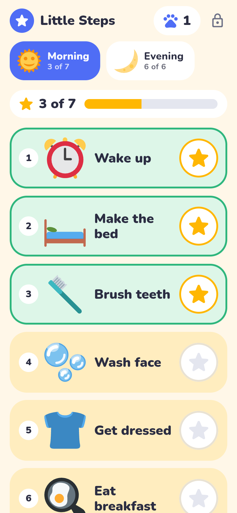
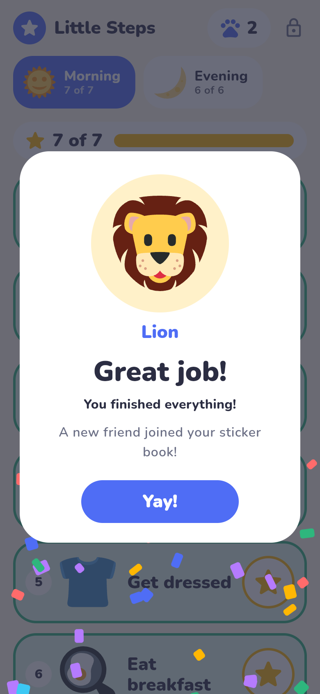
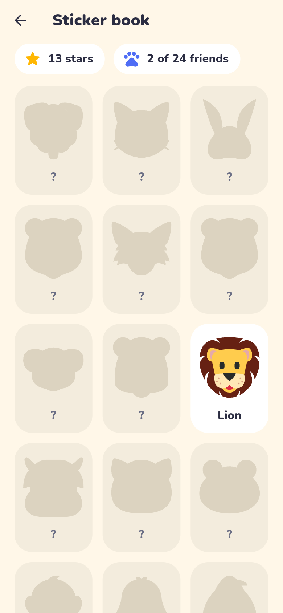
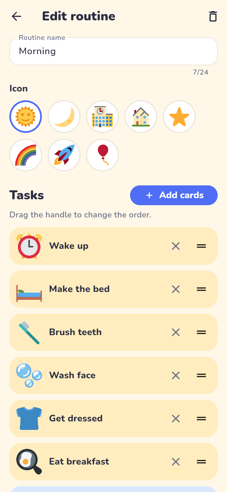
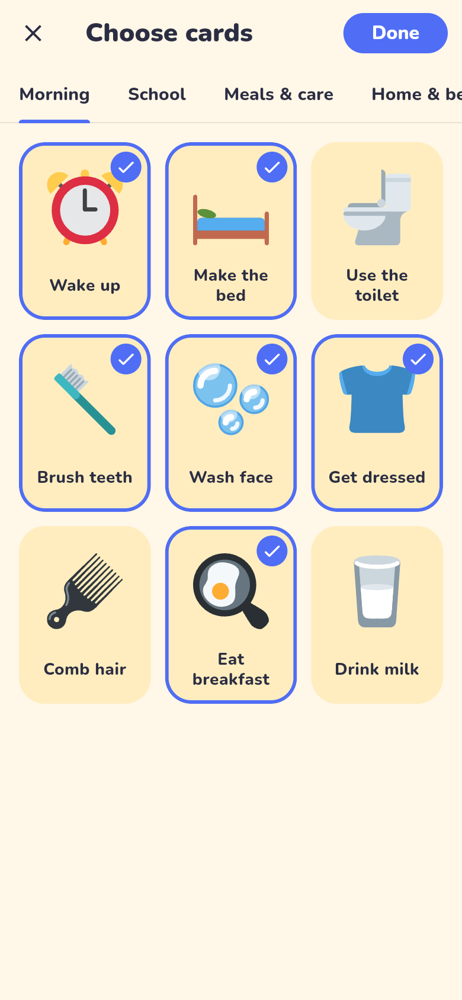
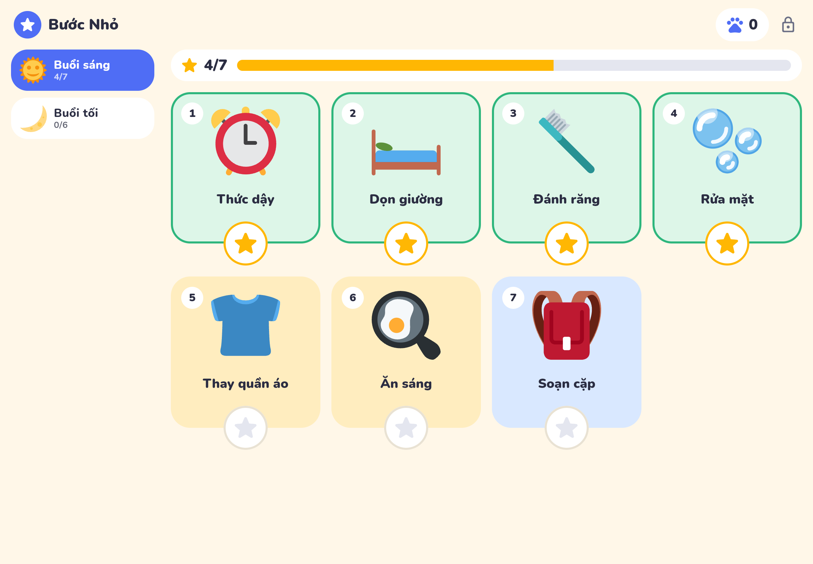

# Little Steps · Từng bước nhỏ

A visual daily-routine board for young children, for phones and tablets.
A grown-up lines up picture cards ("Wake up", "Brush teeth", "Pack my bag");
the child hears each one, taps a star when it is done, and wins an animal
sticker for finishing the whole routine.

Free, offline, no ads, no purchases, no accounts, no data collected.

| Board | Reward | Sticker book | Routine editor | Card picker |
|---|---|---|---|---|
|  |  |  |  |  |



## What it does

**For the child**

- One big card per task, in order, with a number, a picture and a name.
- Tap a card to hear its name. Tap its star to mark it done.
- A progress bar fills as stars are earned.
- Finishing a routine sets off a celebration and adds one new animal friend
  to the sticker book (24 to collect).
- The board starts fresh every morning.

**For the grown-up** (behind a multiplication question)

- Several routines, each with a name and an icon. Morning and Evening are
  there from the start.
- 39 built-in cards in four groups: morning, school, meals and care, home and
  bedtime.
- Make your own cards from a photo and a name.
- Drag tasks to reorder them.
- English and Vietnamese, switchable in the app. Card names are read aloud
  in the app's language.

## Decisions worth pointing out

- **Hearing a task and finishing it are separate targets.** The card speaks,
  the star completes. A child who wants to hear "Brush teeth" again cannot
  tick it off by accident.
- **A sticker is earned once per routine per day.** Undoing and redoing the
  last task does not produce another one, and there is no way to collect
  them without doing the routine.
- **No recorded audio.** Card names are spoken by the device's own
  text-to-speech engine, which keeps the download small and gives every
  language a voice for free. If the device has no voice for the app's
  language, install one in the system text-to-speech settings.
- **Nothing leaves the device.** There is no backend, no analytics SDK and
  no ad SDK. Photos for custom cards are stored in the app's private folder.
  See the [privacy policy](docs/PRIVACY.md).
- **One layout, three shapes.** Below 600 px wide the board is a list of
  rows; above it, a grid of tall tiles; from 840 px the routines move from a
  strip at the top to a rail at the side.

## How it is built

Flutter 3.50 (Dart 3.14), one codebase for Android, iOS and the web.

```
lib/
  main.dart               opens storage, starts the app
  app.dart                MaterialApp, locale, day rollover on resume
  core/                   theme, breakpoints, clock, ids, licences
  data/
    models.dart           Routine, RoutineItem, CustomCard, DayProgress, AppData
    card_catalog.dart     built-in cards, routine icons, stickers
    app_repository.dart   AppData <-> one JSON document in key-value storage
    image_store*.dart     photos: files on mobile, browser storage on web
  state/
    app_controller.dart   every rule of the app, as one Riverpod Notifier
    providers.dart        injectable clock, random, storage, speech
  services/               text-to-speech, photo picker
  features/child/         board, task tile, celebration, sticker book
  features/parent/        gate, routines, editor, card picker, custom cards, settings
  l10n/                   app_en.arb, app_vi.arb (+ generated code)
```

- **State**: `flutter_riverpod`. `AppController` owns an immutable `AppData`
  and persists it after every change. Time, randomness, storage and speech
  are providers, so tests replace them.
- **Storage**: `shared_preferences` holds one small JSON document (routines,
  card names, one day of progress). Photos are separate files.
- **Artwork**: [Twemoji](https://github.com/jdecked/twemoji) SVGs rendered
  with `flutter_svg`. `tool/asset_map.json` maps each file to its emoji.
- **Icon**: drawn by `tool/make_icon.py`, which also writes every Android,
  iOS and web icon size.

## Run it

```sh
flutter pub get
flutter run                 # a connected phone, tablet or emulator
flutter run -d chrome       # in a browser
flutter test                # 57 unit and widget tests
```

Continuous integration (`.github/workflows/ci.yml`) checks formatting,
analyses, runs the tests and builds a release APK, which it attaches to the
run as a downloadable artifact.

## Tests

`test/app_controller_test.dart` covers the rules: stars, the
one-sticker-per-day rule, the new-day reset, editing routines, custom cards,
and saving. `test/app_flow_test.dart` drives the real UI: the board, the
celebration, the parental gate, the editor (including drag-to-reorder), the
card picker, making a card from a photo, switching language, and layout on
five screen sizes from a 320 px phone to a landscape tablet.
`test/app_repository_test.dart` covers storage, including damaged data.

## Status

This is a first MVP. The web build has been exercised end to end in Chrome.
The Android APK is built by CI but has not yet been run on a physical
device, and the iOS project has not been built.

Not in this version: voice recording for custom cards, a visual countdown
timer per task, reminders, profiles for several children, and weekly
history.

Before publishing to a store: replace the debug signing config in
`android/app/build.gradle.kts` with a release key, and host
`docs/PRIVACY.md` at a public URL.

## Credits

- Card, icon and sticker artwork: Twemoji, © Twitter, Inc and other
  contributors, [CC-BY 4.0](https://creativecommons.org/licenses/by/4.0/).
- Font: Nunito, © The Nunito Project Authors,
  [SIL Open Font License 1.1](assets/fonts/OFL.txt).

Picture-card routine boards ("visual schedules") are a long-standing tool in
early-childhood education. This app is an original implementation of that
idea: its name, code, layout and icon were made for this project.
